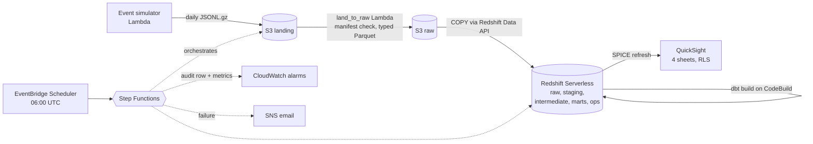
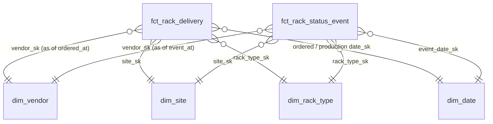

# Rack Delivery Pipeline

**How long does it take to get a server rack from purchase order to serving production traffic, where does it stall, and which vendors and sites miss their delivery SLAs?**

A production-style analytics pipeline that answers that question. Rack lifecycle events land in Amazon S3, dbt models them into a Kimball star schema on Amazon Redshift Serverless, AWS Step Functions runs it every day, and an Amazon QuickSight dashboard, defined entirely as code, answers four questions in under 30 seconds of looking:

1. What percentage of racks reached production within SLA this month, compared with last month?
2. Which lifecycle stage contributes most to p90 cycle time?
3. Which vendor and site combinations are breaching SLA, and which racks are overdue right now?
4. Is today's data trustworthy: did the pipeline run, is the data fresh, is the quarantine rate normal?

## What the dashboard shows

| Sheet | Answers | Visuals |
|---|---|---|
| Executive | Are we delivering on time? | On-time-to-production % this month vs last (target 90%), p90 end-to-end days, racks in flight, overdue open racks, monthly on-time % by vendor, weekly racks to production with a 7-day moving average |
| Cycle Time | Where does the time go? | Median hours per stage by vendor, end-to-end days by site, p90 install hours by site and month, with vendor, site, rack type and order month filters |
| SLA Breaches | Who is late, and which racks? | Overdue open racks sorted by days overdue, breaches by vendor and contract tier, drill-down from vendor to site to rack |
| Pipeline Health | Can I trust today's numbers? | Last run status, hours since the last successful run, quarantine rate per run against a 5% line, cost per run, the last 14 runs |

Row-level security restricts each reader to their own region's sites. Every visual is titled with the question it answers. Full spec: [docs/DASHBOARD_SPEC.md](docs/DASHBOARD_SPEC.md).

## Architecture



- **Orchestration:** Step Functions runs simulate, land, load, `dbt build` (CodeBuild, `.sync`), audit, and QuickSight ingestion. Any failure routes to SNS.
- **No idle cost:** Redshift Serverless runs with a daily RPU usage limit, and CodeBuild bills per build minute. There is no NAT gateway, no MWAA and no always-on compute.
- **Infrastructure as code:** Terraform with remote state. Every resource is tagged `project=rack-delivery-pipeline`.
- **Two dbt targets:** every model runs unchanged on Redshift and on a local DuckDB file. Dialect differences live in adapter-dispatched macros (`dbt/macros/`), so the whole pipeline is developed and tested without an AWS account.

## The data

Real rack procurement data is not public, so `simulator/` generates it, with the problems a real feed has. Each rack moves through 10 statuses, from `ORDERED` to `DECOMMISSIONED`. Durations are drawn per vendor, site and rack type, and the six vendors have distinct personalities: one reports sloppily, one degrades mid-history, one has its SLA tightened. The simulator also writes the true milestone timestamps per rack, so tests can check that the pipeline recovers the truth.

A full 24-month history (Oct 2024 to Sep 2026, seed 42) is 50,627 racks and 397,611 events in 729 daily files, generated in about 35 seconds. Daily mode continues the same racks from saved state, byte for byte what a full run would produce.

Defects are injected deliberately and measured on every run:

| Defect | Configured | Measured |
|---|---|---|
| Duplicate event_id (re-emitted in a later file) | 1.50% | 1.51% |
| Event arrives 30 to 60 days late | 0.20% | 0.20% |
| Event arrives 3 to 10 days late (per vendor, V04 shown) | 8.00% | 8.17% |
| File lines out of order | 5.00% of files | 5.08% |
| Timestamp format drift (offset or epoch millis) | 10.00% | 10.11% |
| Schema drift: V04 renames `rack_type_code` from 2026-03-01 | all V04 rows | 100% |
| Invalid transition (e.g. RECEIVED to PRODUCTION) | 0.30% | 0.28% |
| Legitimate regression (failed burn-in) | 1.00% of racks | 1.02% |
| Future-dated event (clock bug, +1 year) | 0.05% | 0.05% |
| Missing `recorded_by` | 4.00% | 4.03% |
| Missing day (no file, next day doubles) | 1 day | 2025-08-17 |

## How late and bad data are handled

| Problem | Where | Handling |
|---|---|---|
| Re-delivered files | `land_to_raw` | File md5 checked against `ops.file_manifest`; a file already loaded is skipped. |
| Duplicate events | `stg_rack_events` | `QUALIFY row_number()` per `event_id`, keeping the copy loaded last. All 5,917 injected duplicates removed. |
| Three timestamp formats | `parse_event_at` macro | Parsed to naive UTC; 0 nulls across 391,694 staged events. |
| Schema drift | raw + staging | Raw keeps both columns; staging maps `rack_model` back by `payload_version`. |
| Invalid transitions | `int_rack_events_checked` | Checked against an allowed-transition seed in two passes, so one bad event does not also condemn the real event after it. |
| Future-dated events | `int_rack_events_checked` | Compared with the row's load time, not wall-clock now, so a rebuild always reaches the same verdict. |
| Late events | incremental facts | Ordering uses event time, not arrival time. Each run recomputes every rack with an event ingested in the last 14 days, so a late event lands in place and fixes the durations around it. |
| Stale or missing data | dbt source freshness, row-count test | The run fails if raw data is older than 26 hours; a day outside 50% to 200% of the trailing 7-day mean raises a warning. |

Rows that fail a check go to `ops.quarantine_rack_events` with a reason and never reach the marts. Quarantine counts track what was injected:

| Reason | Quarantined | Injected |
|---|---|---|
| future_dated | 207 | 207 |
| invalid_transition | 1,203 | 1,112 |

The 91 extra invalid transitions are real events whose predecessor has not arrived yet; they clear on the next build once the late event lands. 179 gaps left by future-dated events are bridged and flagged `is_gap_bridged` rather than quarantined, because the missing status did arrive, only with a broken timestamp.

## Data model



| Model | Type | Grain | Rows |
|---|---|---|---|
| `fct_rack_status_event` | transaction fact, incremental | one valid status change | 390,284 |
| `fct_rack_delivery` | accumulating snapshot, incremental | one rack | 50,612 |
| `dim_vendor` | SCD Type 2 | one contract version | 9 |
| `dim_site`, `dim_rack_type` | SCD Type 1 | one site / rack type | 20 / 8 |
| `dim_date` | generated | one day, 2023 to 2028 | 2,192 |
| `agg_cycle_time_monthly`, `agg_daily_throughput`, `agg_sla_vendor_monthly` | aggregates feeding SPICE | month x vendor x site x stage, site x day, vendor x month | |

**Why an accumulating snapshot.** The business question is about a rack's journey, so `fct_rack_delivery` keeps one row per rack and fills in milestone timestamps (first time each status was reached, so regressions do not reset them) and stage durations as they happen. The event-grain fact keeps the full history for questions about individual transitions.

**SCD2 vendor contracts.** Vendor SLAs change mid-history, and each rack is judged against the SLA in effect when it was ordered: an as-of join on `valid_from <= ordered_at < valid_to`. `dim_vendor` comes from a dbt snapshot with the check strategy. A snapshot only records what it sees when it runs, so `ops/snapshot_replay.py` replays contract history once per change date on a backfill, and the daily run captures changes as they land:

| Vendor | Versions |
|---|---|
| V02 | 50-day SLA, then 55 days from 2026-05-01 |
| V03 | 45-day SLA, then 35 days from 2025-06-01 |
| V05 | gold tier, then silver from 2026-01-01 |
| others | one version |

**Incremental and idempotent.** Both facts recompute whole racks rather than single events: every rack with an event ingested in the last 14 days, or in `[start_date, end_date]` for a backfill. `merge` on Redshift, `delete+insert` on DuckDB, chosen by an adapter-dispatched macro. Running the same backfill twice produces identical row counts and md5 checksums.

**Contracts and the semantic layer.** Every mart has an enforced dbt model contract: each column is declared with an explicit type, and a breaking change fails the build before the table is replaced. On top of the marts, `dbt/models/semantic/` defines 12 governed KPIs (on-time delivery rate, p90 end-to-end days, overdue open racks and more) in the dbt Semantic Layer. They are the single definition of each metric, and the grounding for the natural-language query service in [metric-layer-nlq](https://github.com/meetshah27/metric-layer-nlq).

**Analytical SQL used:** `LAG`/`LEAD` (transition checks, time since previous event), gaps and islands (`int_rack_status_islands`), conditional-aggregation pivot (milestones), `PERCENTILE_CONT ... WITHIN GROUP` (cycle-time percentiles), SCD2 as-of joins, moving averages and running totals (`agg_daily_throughput`), `QUALIFY` dedupe, and order-month cohort analysis (`dbt/analyses/`). Full design: [docs/DATA_MODEL.md](docs/DATA_MODEL.md).

## Results

| Check | Result |
|---|---|
| Pipeline recovers the true production date (simulator ground truth) | 99.88% of 50,627 racks match exactly; the build fails below 99% |
| Backfill idempotency | Two runs of June 2025 produce identical row counts and md5 checksums for both facts |
| Incremental vs full rebuild | Identical row counts and checksums |
| Data quality coverage | 126 dbt nodes build with 0 errors |

All 61 racks that don't match the ground truth are explained: 26 had their `PRODUCTION` event quarantined as future-dated, and 35 have a `PRODUCTION` or `BURN_IN` event that arrives after the end of the history window.

What the data shows:

- **Vendor lead time drives cycle time.** Of a median 38.8 days from order to production, 25.6 are spent waiting for the vendor to ship; transit, install and burn-in take 4.6, 4.2 and 3.0.
- **V05's degradation is visible.** Its on-time rate falls from 84% in H1 2025 to 40% in Apr to Sep 2026 as its lead times stretch.
- **The SCD2 join matters.** V03's on-time rate drops from 99.8% to 88.5% after its SLA tightened from 45 to 35 days, without any change in how it performs. A dimension that kept only the current SLA would misreport its history.

## Observability and cost

- Every run writes a row to `ops.pipeline_run_audit`: rows landed, loaded, quarantined and merged, late events, dbt tests passed, warned and failed, Redshift charged seconds, and estimated cost.
- CloudWatch metrics (`RackPipeline` namespace) feed two alarms: quarantine rate above 5%, and any failed execution.
- Cost per run is computed from `SYS_SERVERLESS_USAGE` charged seconds times the RPU-hour price held in SSM. `make cost` prints the last 30 runs.
- Guardrails: a Redshift usage limit that turns off user queries at the daily cap, the daily schedule created disabled, and an AWS Budgets action that denies new spend at $1.

## How to run

Prerequisites: [uv](https://docs.astral.sh/uv/) and GNU Make; Python 3.12 is installed by uv.

Locally, no AWS account needed:

```sh
make setup        # dependencies, dbt packages, pre-commit hooks
make sim          # 24 months of events into ./out; `make sim DAYS=60` for a short run
make dbt-local    # landing -> raw Parquet, SCD2 replay, dbt build on DuckDB
make test         # simulator tests, dbt tests, sqlfluff
make backfill START=2025-06-01 END=2025-06-30   # rebuild a window, print counts and checksums
make ground-truth # how well the facts recover the true milestones
make mf-validate  # semantic layer checks
```

On AWS (`.env` from `.env.example`):

```sh
make tf-apply     # S3, Redshift Serverless with usage limit, IAM, SNS, SSM
make upload && make dbt-build
make schedule-on  # daily runs; make schedule-off to pause
make qs-deploy    # QuickSight datasets, analysis and dashboard from JSON
make cost
make teardown
```

CI runs lint, strict type checks, the simulator tests, a dbt build on a 60-day simulation, the semantic-layer validation, and the backfill idempotency check on every push.

## Repository layout

```
simulator/       event generator with deliberate defects, config.yaml, tests
orchestration/   land_to_raw conversion, Lambda handlers, Step Functions definition
dbt/             staging, intermediate, marts, ops and semantic models; snapshots, macros, seeds, tests, analyses
infra/           Terraform: bootstrap state, modules, dev environment
ops/             snapshot replay, backfill, ground-truth report, cost report, QuickSight deploy and snapshot
dashboards/      QuickSight dashboard definition JSON
docs/            spec, data model, dashboard spec, simulator spec, build plan
```

## Implementation status

| Part | Status |
|---|---|
| Simulator, raw conversion, dbt staging through marts, SCD2, contracts, semantic layer, backfill and ground-truth checks | Built and verified on DuckDB (numbers above) |
| Terraform, Lambda ingestion, Step Functions, CodeBuild, CloudWatch, QuickSight as code | Specified in `docs/`, not yet deployed; built and run in one cost-capped AWS window, then torn down ([plan](docs/DEPLOY_WINDOW.md)) |

## Limitations

- The data is synthetic: the rates and vendor personalities are designed, not observed.
- The spec's targets of about 50k racks and 2 to 4 million events cannot both hold, because a rack has at most about 10 events. The simulator keeps the rack count; `base_daily_orders` in `simulator/config.yaml` scales volume.
- Quarantine is rebuilt each run, so it shows the current verdict; per-run counts live in the audit table.
- `days_in_current_status` is refreshed every run for open racks only; for racks already in production it is as of their last recompute.
- The ground-truth test reads the simulator's `racks.parquet`, which must be loaded into `ground_truth.racks` on Redshift.
