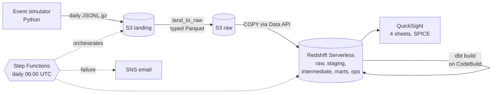

# Rack Delivery Pipeline

How long does it take to get a server rack from purchase order to serving production traffic, where does it stall, and which vendors and sites miss their delivery SLAs?

This repo answers that with a production-style analytics pipeline. Synthetic rack lifecycle events land in Amazon S3, dbt models them into a Kimball star schema on Amazon Redshift Serverless, AWS Step Functions runs it daily, and Amazon QuickSight shows the results.

> **Status: in progress.** The local track runs end to end on DuckDB with no AWS account: the event simulator, raw ingestion, and the dbt staging, validation and quarantine layers. The star schema, AWS deployment and dashboard are next. See [Roadmap](#roadmap).

## The questions the dashboard will answer

1. What percentage of racks reached production within SLA this month, compared with last month?
2. Which lifecycle stage contributes most to p90 cycle time?
3. Which vendor and site combinations are breaching SLA, and which racks are overdue right now?
4. Is today's data trustworthy (pipeline ran, data fresh, quarantine rate normal)?

## Architecture



The local track runs the same dbt models against DuckDB, reading the raw Parquet straight from disk. Every model is written to run unchanged on both targets: dialect differences live in adapter-dispatched macros (`dbt/macros/`).

## The data

Real rack procurement data is not public, so `simulator/` generates it, with the problems a real feed has. Each rack moves through 10 statuses, from `ORDERED` to `DECOMMISSIONED`. Durations are drawn per vendor, site and rack type, and vendors have distinct personalities (one sloppy reporter, one that degrades mid-history, one whose SLA tightens). The simulator also writes the true milestone timestamps per rack, so tests can check that the pipeline recovers the truth.

A full 24-month run (Oct 2024 to Sep 2026, seed 42) produces:

| | |
|---|---|
| Racks | 50,627 |
| Event lines landed | 397,611 in 729 daily files |
| Run time | about 35 seconds |

Defects are injected deliberately, at configured rates, and measured on every run:

| Defect | Configured | Measured |
|---|---|---|
| Duplicate event_id (re-emitted in a later file) | 1.50% | 1.51% |
| Event arrives 30 to 60 days late | 0.20% | 0.20% |
| Event arrives 3 to 10 days late (per vendor, V04 shown) | 8.00% | 8.17% |
| File lines out of order | 5.00% of files | 5.08% |
| Timestamp format drift (offset or epoch millis) | 10.00% | 10.11% |
| Schema drift: V04 renames `rack_type_code` from 2026-03-01 | all V04 rows | 100% |
| Invalid transition (e.g. RECEIVED to PRODUCTION) | 0.30% | 0.28% |
| Legitimate regression (failed burn-in) | 1.00% of racks | 1.02% |
| Future-dated event (clock bug, +1 year) | 0.05% | 0.05% |
| Missing `recorded_by` | 4.00% | 4.03% |
| Missing day (no file, next day doubles) | 1 day | 2025-08-17 |

Reproduce: `make sim` prints this table.

## How late and bad data are handled

| Problem | Where | Handling |
|---|---|---|
| Duplicates | `stg_rack_events` | `QUALIFY row_number()` per `event_id`, keeping the copy loaded last. All 5,917 injected duplicates removed. |
| Three timestamp formats | `parse_event_at` macro | Parsed to naive UTC; 0 nulls across all 391,694 staged events. |
| Schema drift | raw + staging | Raw keeps both columns; staging maps `rack_model` back by `payload_version`. |
| Invalid transitions | `int_rack_events_checked` | Checked against the allowed-transition seed in two passes, so one bad event does not also condemn the real event after it. |
| Future-dated events | `int_rack_events_checked` | Compared with the row's load time, not wall-clock now, so a rebuild always reaches the same verdict. |
| Late events | lookback window (Phase 5) | Ordering uses event time, not arrival time; `late_by_days` is kept for the audit metric. |

Rows that fail a check go to `ops.quarantine_rack_events` with a reason and never reach the marts. Quarantine counts match what the simulator injected:

| Reason | Quarantined | Injected |
|---|---|---|
| future_dated | 207 | 207 |
| invalid_transition | 1,203 | 1,112 |

The 91 extra invalid transitions are real events whose predecessor has not arrived yet (it lands after the window ends) plus a few back-to-back defects. They clear on the next build once the late event lands. 179 gaps left by future-dated events are bridged and flagged `is_gap_bridged` rather than quarantined, because the missing status did arrive, only with a broken timestamp.

Reproduce: `make sim && make dbt-local`, then:

```sql
-- duckdb local/warehouse.duckdb
select reason, count(*) from ops.quarantine_rack_events group by 1;
```

## Data model

dbt layers: `staging` (views, typed and deduplicated), `intermediate` (validation, gaps and islands), `marts` (star schema), `ops` (quarantine and run audit).

The star schema (Phase 5) has two facts at different grains sharing conformed dimensions:

- `fct_rack_status_event`: transaction fact, one row per valid status change.
- `fct_rack_delivery`: accumulating snapshot, one row per rack, with milestone timestamps and stage durations updated in place.
- `dim_vendor` is SCD Type 2, because vendor SLAs change over time and each rack is judged against the SLA in effect when it was ordered.

Full design: [docs/DATA_MODEL.md](docs/DATA_MODEL.md).

## Run it locally

Prerequisites: [uv](https://docs.astral.sh/uv/) and GNU Make. Python 3.12 is installed by uv. No AWS account is needed.

```sh
make setup        # dependencies, dbt packages, pre-commit hooks
make sim          # 24 months of events into ./out (about 35 s); `make sim DAYS=60` for a short run
make dbt-local    # landing -> raw Parquet, then dbt build on ./local/warehouse.duckdb
make test         # simulator tests, dbt tests, sqlfluff
```

Continue the simulation one day at a time from saved state, the way the scheduled pipeline will:

```sh
uv run python -m simulator.generator --daily --date 2026-10-01 --out ./out
```

CI runs lint, strict type checks, the simulator tests, and a full dbt build on a 60-day simulation on every push.

## Repository layout

```
simulator/       event generator, config.yaml, tests
orchestration/   land_to_raw conversion (Lambda handlers and state machine to come)
dbt/             models (staging, intermediate, marts, ops), macros, seeds, tests
infra/           Terraform (Phase 2)
ops/             cost report, backfill and QuickSight scripts (later phases)
dashboards/      QuickSight definition JSON (Phase 7)
docs/            specs and build plan
```

## Roadmap

| Phase | | Status |
|---|---|---|
| 0 | Scaffold, tooling, CI | Done |
| 1 | Event simulator with defects | Done |
| 4 | dbt staging, validation, quarantine | Done on DuckDB |
| 5 | Dimensions, SCD2, facts, idempotent backfill, ground-truth check | Next |
| 2, 3 | Terraform, S3 to Redshift ingestion | Deployment window |
| 6 | Step Functions, EventBridge schedule, alarms, cost per run | Deployment window |
| 7 | QuickSight dashboard as code with row-level security | Deployment window |
| 8, 9 | Results, evidence capture, teardown | Deployment window |

The AWS work runs in one short window, inside the free trials, and is then torn down so the project costs $0. The plan is in [docs/DEPLOY_WINDOW.md](docs/DEPLOY_WINDOW.md).

## Limitations

- The data is synthetic. The rates and personalities are designed, not observed.
- The spec targets about 50k racks and 2 to 4 million events, which cannot both hold: a rack has at most about 10 events. The simulator keeps the rack count; raising `base_daily_orders` in `simulator/config.yaml` scales event volume.
- The Redshift target is configured but has not been run yet; it is verified in the deployment window.
- Quarantine is rebuilt on each run, so it shows the current verdict rather than a history; the run audit (Phase 6) will record per-run counts.
